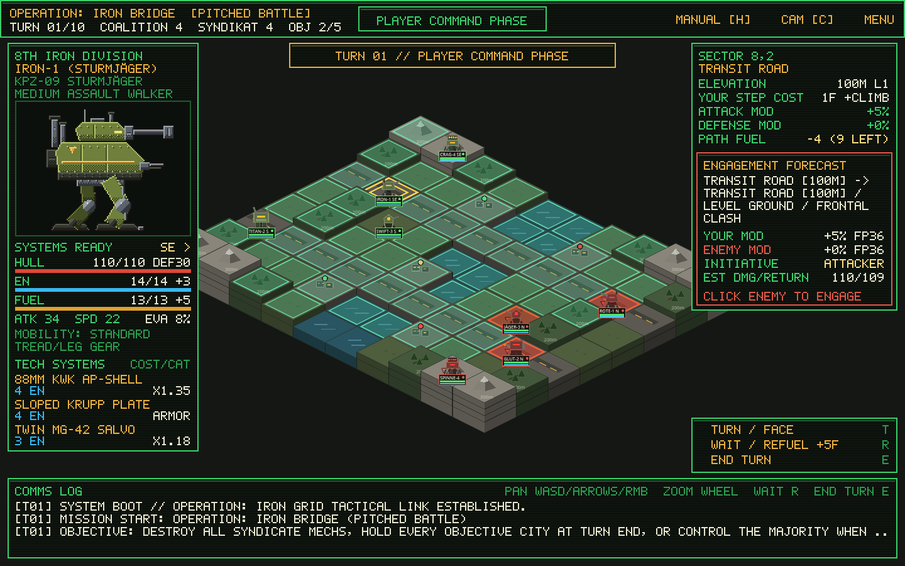
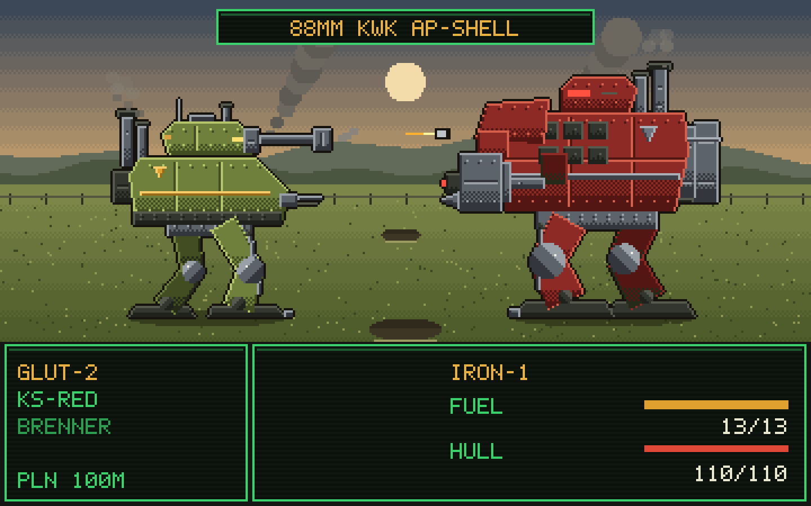
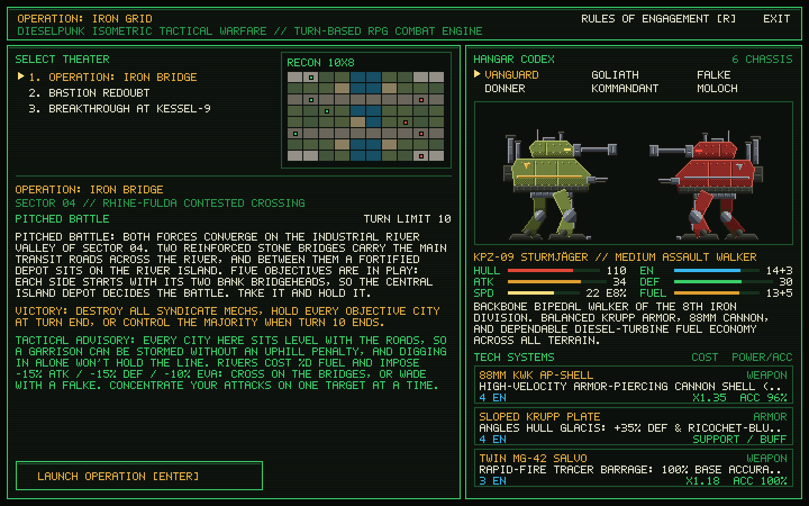

# Operation: Iron Grid

**Operation: Iron Grid** is a dieselpunk isometric turn-based tactical strategy game built in **Godot 4**. Inspired by the heavy mechanical atmosphere of *Ring of Red*, *Steel Battalion*, and *MechWarrior*, the grid-based tactical maneuvering of *Advance Wars* and *Fire Emblem*, and classic *Final Fantasy* turn-based RPG combat encounters.



*Tactical battlefield view: extruded 2.5D isometric terrain, movement range highlights, Dijkstra fuel path planning, and real-time telemetry HUD.*



*Battle screen: pixel-art walkers with articulated legs, a terrain backdrop chosen by the defender's tile, attack banners, and the CRT command HUD.*



*Command HQ briefing console: 3 selectable battle theaters, satellite reconnaissance preview, and interactive Armored Walker Hangar Codex.*

---

## Core Gameplay & Turn Loop

Players command the **8th Iron Division** against the **Kriegs-Syndikat Red** across an extruded 2.5D isometric battlefield divided into square tactical nodes with varying terrain types and elevations (`0m` to `400m`).

Each turn cycles through three phases:

1. **Player Command Phase**:
   - Select any friendly Armored Fighting Walker (AFW) to compute reachable movement nodes within its current **Diesel Fuel** budget (using Dijkstra pathfinding across terrain and elevation climbs).
   - Hover over reachable enemy nodes to inspect a real-time **Skirmish Engagement Forecast** detailing approach vectors, terrain/elevation modifiers, initiative order, and estimated hull damage.
   - Move to secure strategic **Objective Cities**, press **`R`** (`WAIT / REFUEL`) to entrench (`+15% DEF`, `+5 Fuel`, `+4 EN`, and `+8 Hull` when holding a City), or move directly onto an enemy-occupied node to trigger a combat encounter.
2. **Skirmish Resolution Phase (Final Fantasy Turn-Based Battle)**:
   - When two opposing walkers occupy the same node, the game cuts from the isometric grid to a side-view **Final Fantasy-style Turn-Based Battle** against a terrain backdrop matching the contested sector.
   - **Initiative & Rounds**: Combat runs in classic turn-based rounds determined by each walker's **Effective Speed (`SPD`)**, with a Round-1 Assault Initiative bonus (`+8 SPD`) for the initiating Attacker. An **Entrenched** Defender answers with `+10 SPD` in Round 1 (`+4` for the rest of the fight) plus `+5% EVA` and `+6% Hit`. The forecast's `INITIATIVE` line is read from the same Round-1 queue the battle uses.
   - **4-Command Battle Menu**:
     - **`ATTACK`**: Fires the chassis's primary standard weapon (`0 EN` cost).
     - **`TECH`**: Opens the chassis's 3 specialized **Combat Abilities** (`WEAPON`, `ARMOR`, and `TACTIC` modules) powered by **Reactor Energy (`EN`)**:
       - **Weapon TECHs**: Heavy ordnance, high-velocity AP shells, rocket salvos, and melee pile-bunkers with custom accuracy, critical hit bonuses, and armor penetration.
       - **Armor & Tactical TECHs**: Once-per-battle support/status turns that deploy physical shields (`Sloped Krupp Plate`, `Ferro-Bunker Bulkhead`, `Quad Anchor Struts`, `Reactive Shield Wall`), boost offensive/evasive telemetry (`Gyro-Flank Thrusters`, `Optical Rangefinder`, `Elevation Ballistics`, `Command Uplink`), or jam enemy targeting (`Enigma ECM Scrambler`).
     - **`DEFEND`**: Braces hull plating (`-50%` damage from the enemy's next hit) and vents reactor coils (`+2 EN`). Like a shield, the guard holds through misses, support turns and an initiative flip, and is spent by the first shot that lands.
     - **`RETREAT`**: Attempts an emergency combat disengagement based on relative Speed (`SPD`). If successful, the battle ends immediately and the retreating unit withdraws to an open adjacent sector. A defender only loses its entrenchment when it is destroyed, routed or pushed back, never because the attacker broke off.
   - Each encounter continues until one walker is destroyed (`0 HULL`), one side successfully retreats, or the 10-round safety limit is reached (dislodging the loser of the exchange).
3. **Syndicate AI Phase**:
   - Enemy walkers evaluate reachable tiles, approach vectors, high-ground advantages, fuel reserves, and objective priorities tailored to the map's strategic profile (`Pitched Battle`, `Fortified Defense`, or `Blitzkrieg Offense`).

### Victory Conditions
- **Annihilation** of either side ends the mission immediately.
- **Objective victories** (holding every bridgehead, holding a Syndicate HQ bunker, or the Syndicate overrunning every Citadel node) are confirmed at the **end of a full turn**, so a capture has to survive the enemy's response phase.
- When the **turn limit** expires, the mission is scored by its strategic profile (bridgehead majority, Citadel held, or HQ not taken).

---

## Terrain & Elevation Matrix

| Terrain Type | Code | Base Fuel | Attack Mod | Defense Mod | Evasion Bonus | Tactical Notes |
| :--- | :---: | :---: | :---: | :---: | :---: | :--- |
| **Transit Road** | `ROD` | `1` | `+5%` | `0%` | `+0%` | Fastest transit artery for heavy dreadnoughts |
| **Open Plain** | `PLN` | `2` | `0%` | `+5%` | `+0%` | Standard open maneuvering ground |
| **Fortified City** | `CTY` | `2` | `+10%` | `+25%` | `+10%` | Repairs **+12 Hull**, restores **+4 Fuel** & **+3 EN** at turn start |
| **Trench Timber** | `TRN` | `3` | `+5%` | `+15%` | `+8%` | Prepared defensive cover and ambush concealment |
| **River Ford** | `RIV` | `4` | `-15%` | `-15%` | `-10%` | Bogged down & exposed (`Falke` amphibious gear reduces cost) |
| **Mountain Crag** | `MTN` | `5` | `+15%` | `+30%` | `+10%` | Commanding rock bastion (`Donner` quad legs reduce climb cost) |

### Elevation (`0m` – `400m`)
- **Climbing Fuel Surcharge**: Moving uphill costs `+1 Fuel` per `100m` elevation level gained.
- **High Ground Plunging Fire**: Whichever walker holds the higher tile gains **+4% Hit Accuracy**, **+4% Evasion** and **+5% Crit** per elevation level. Attacking downhill also grants **+12% Firepower** and **+10% Armor deflection** per level, while the defender below loses **8% Firepower and Armor** per level.
- **Uphill Assault Penalty**: Attacking uphill suffers **-10% Firepower** and **-4% Hit Accuracy** per level, and the defender above gains **+12% Firepower and Armor** per level.

---

## Armored Fighting Walkers (6 Chassis Types)

Stats are read from `autoload/GlobalState.gd`; `EN (+n)` is the reactor pool and its per-turn regen, `Fuel (+n/turn)` the diesel tank and its passive refuel. Each chassis's `ATTACK` fires its basic gun for `0 EN`.

1. **KPZ-09 "Sturmjäger" (`VANGUARD` — Medium Assault Walker)**
   - **Stats**: `110 Hull` | `14 EN (+3)` | `34 ATK` | `30 DEF` | `22 SPD` | `8% EVA` | `10% CRIT` | `13 Fuel (+5/turn)`
   - **Basic Gun**: *88mm KwK* — **TECH Systems**: *88mm KwK AP-Shell*, *Sloped Krupp Plate*, *Twin MG-42 Salvo*
2. **VK-100 "Siegebreaker" (`GOLIATH` — Super-Heavy Dreadnought)**
   - **Stats**: `155 Hull` | `14 EN (+3)` | `46 ATK` | `44 DEF` | `12 SPD` | `3% EVA` | `8% CRIT` | `10 Fuel (+4/turn)`
   - **Basic Gun**: *Quad Flak-38* — **TECH Systems**: *210mm Siege Howitzer*, *Ferro-Bunker Bulkhead*, *Quad Flak-38 Battery*
3. **Sd.Kfz-22 "Spähfalke" (`FALKE` — Light Recon Strider)**
   - **Stats**: `85 Hull` | `16 EN (+4)` | `28 ATK` | `21 DEF` | `34 SPD` | `18% EVA` | `16% CRIT` | `17 Fuel (+6/turn)`
   - **Basic Gun**: *50mm Autocannon* — **TECH Systems**: *50mm Rapid Autocannon*, *Gyro-Flank Thrusters*, *Optical Rangefinder*
4. **SPG-88 "Spinne" (`DONNER` — Quadruped Mountain Walker)**
   - **Stats**: `98 Hull` | `15 EN (+3)` | `43 ATK` | `26 DEF` | `18 SPD` | `7% EVA` | `12% CRIT` | `12 Fuel (+5/turn)`
   - **Basic Gun**: *Nebelwerfer Rocket Pod* — **TECH Systems**: *Nebelwerfer Rocket Pod*, *Elevation Ballistics*, *Quad Anchor Struts*
5. **Befehls-IV "Kaiserstuhl" (`KOMMANDANT` — Tactical Command Walker)**
   - **Stats**: `120 Hull` | `18 EN (+4)` | `36 ATK` | `34 DEF` | `24 SPD` | `10% EVA` | `12% CRIT` | `14 Fuel (+5/turn)`
   - **Basic Gun**: *105mm StuH* — **TECH Systems**: *Enigma ECM Scrambler*, *Command Uplink*, *105mm StuH Howitzer*
6. **Sturm-V "Brenner" (`MOLOCH` — Heavy Urban Brawler)**
   - **Stats**: `135 Hull` | `14 EN (+3)` | `41 ATK` | `38 DEF` | `19 SPD` | `6% EVA` | `12% CRIT` | `12 Fuel (+5/turn)`
   - **Basic Gun**: *Thermite Flame Lance* — **TECH Systems**: *Thermite Flame Lance*, *Hydraulic Pile-Bunker*, *Reactive Shield Wall*

---

## Battle Arenas (3 Maps)

1. **Operation: Iron Bridge (`PITCHED BATTLE`)**
   - Symmetrical meeting engagement across the Rhine-Fulda river valley (`0m`) spanned by two transit road bridges (`100m`), four bridgehead cities (`200m`), and flanking mountain ridges (`300m`).
2. **Bastion Redoubt (`FORTIFIED DEFENSE`)**
   - Asymmetric defense of Citadel Höhenburg (`300m–400m`) against a numerically superior 5-walker Syndicate assault column advancing up the western valley roads.
3. **Breakthrough at Kessel-9 (`BLITZKRIEG OFFENSE`)**
   - Asymmetric offensive leading a 5-walker mobile spearhead to breach entrenched Syndicate gate guards and capture and hold the Eastern HQ Bunker within 10 turns.

---

## Controls

| Input | Action |
| :--- | :--- |
| **Left Mouse Click** | Select walker / Move to highlighted tile / Engage enemy node |
| **Right / Middle Mouse Drag** | Pan tactical camera |
| **WASD / Arrow Keys** | Pan tactical camera (or navigate battle command menu) |
| **Mouse Wheel Up / Down** | Zoom camera in / out |
| **`R`** | Wait, Entrench (`+15% DEF`), & Refuel (`+5 Fuel`, `+4 EN`) selected walker |
| **`E`** | End Player Command Phase |
| **`C`** | Reset & center camera on battlefield |
| **`H`** | Toggle Tactical Field Manual & Terrain Chart |
| **`Up` / `Down` / Mouse Hover** | Battle screen: highlight `ATTACK` / `TECH` / `DEFEND` / `RETREAT` |
| **`Space` / `Enter` / Left Click** | Battle screen: confirm command or confirm battle result |
| **`Esc` / `Backspace` / Right Click** | Battle screen: exit `TECH` sub-menu (or deselect unit on map) |
| **`A`** | Battle screen: toggle AI Auto-Pilot for Coalition turns |
| **`S`** | Battle screen: toggle 1× / 2× playback speed |

---

## Architecture & Project Structure

```text
iron-grid/
├── project.godot                   # Godot 4.7 project configuration & autoloads
├── icon.svg                        # Custom vector project icon
├── screenshot_main_menu.png        # Command HQ briefing & codex screenshot
├── screenshot_gameplay.png         # Tactical isometric battlefield screenshot
├── autoload/
│   ├── GlobalState.gd              # Global turn/phase state, ability/mech/map catalogs, combat log
│   └── SoundManager.gd             # Procedural retro/dieselpunk WAV audio synthesizer
├── assets/battle/                  # Generated pixel art (do not hand-edit; see Battle Art Pipeline)
│   ├── mechs/                      # <chassis>[_variant]_<faction>.png pose sheets + <chassis>.json anchors
│   ├── backdrops/                  # 360x152 terrain backdrops (plain, road, river, forest, city, mountain)
│   ├── fx/                         # Slab, radio mast & rangefinder attachments per faction
│   └── font/                       # 5x7 bitmap font
├── tools/battle_sprites/           # Stdlib-only Python generator for everything in assets/battle
├── scenes/
│   ├── MainMenu.tscn               # Command HQ briefing console, 3-map selector & Mech Hangar Codex
│   ├── Battlefield.tscn            # Root battle scene (GridMap, UnitContainer, Camera2D, UIOverlay)
│   └── dev/BattlePreview.tscn      # Dev-only battle screen preview (every chassis, ability, terrain)
└── scripts/
    ├── data/
    │   ├── CombatAbility.gd        # Turn-based RPG ability struct (EN cost, power, accuracy, effects)
    │   ├── GridTileData.gd         # Terrain type, elevation, fuel cost & combat modifier struct
    │   ├── MapDefinition.gd        # Arena layout, strategy mode, objectives & unit spawns
    │   └── MechData.gd             # Core walker struct (hull, energy, firepower, armor, speed, abilities)
    ├── battle/
    │   ├── Battlefield.gd          # Turn flow controller (Player -> Skirmish Resolution -> AI)
    │   ├── IsoGridMap.gd           # 2.5D isometric terrain renderer & Dijkstra fuel pathfinder
    │   ├── UnitContainer.gd        # Y-sorted mech manager, collision checks & knockback logic
    │   ├── MechUnit.gd             # Procedural multi-part isometric mech renderer & animator
    │   ├── SkirmishEngine.gd       # Final Fantasy turn-based battle session & tactical AI resolver
    │   └── AIController.gd         # Utility-based tactical AI decision engine
    ├── battle_screen/
    │   ├── BattleScreen.gd         # FF-style resolution screen (SubViewport 360x225, scaled 4x)
    │   ├── BattleStage.gd          # Phase machine + interactive command menu + HUD + animations
    │   ├── BattleTimeline.gd       # TurnStep -> presentation beats (weapon, support, defend, retreat)
    │   ├── WeaponAnims.gd          # Per-weapon attack animations
    │   ├── SupportAnims.gd         # Armor/tactical effects, defend/retreat poses, attachments
    │   ├── BattleFX.gd             # Pixel effect primitives (flashes, tracers, explosions, panels)
    │   ├── BattleLayout.gd         # Side/elevation placement & terrain -> backdrop
    │   ├── MechSpriteBank.gd       # Sprite sheet + anchor metadata loader
    │   ├── PixelFont.gd            # 5x7 bitmap text & wrapping
    │   └── BattlePreview.gd        # Dev preview controller
    └── ui/
        ├── MainMenu.gd             # War-room menu & interactive Mech Hangar Codex
        └── UIOverlay.gd            # In-game CRT telemetry HUD, terrain inspector & forecast
└── tests/
    ├── Playtest.tscn               # Headless automated playtest entry scene
    ├── playtest.gd                 # Rule checks + full-mission playthroughs with per-frame invariants
    ├── BattleScreenTests.tscn      # Battle screen unit tests (timeline, layout, anims, screen contract)
    └── run_battle_tests.sh         # Headless runner for the battle screen tests
```

---

## Running the Game

1. Open **Godot Engine 4.x** (tested with Godot `4.7-stable`).
2. Import `project.godot` and press **F5** (or run from the command line):

```powershell
godot --path .
```

---

## Automated Playtest

`tests/Playtest.tscn` checks the core rules (fuel costs, optimal pathfinding, skirmish forecasts, turn-based combat sessions, elevation modifiers, and victory conditions). It then plays complete missions on every map with greedy, turtle, and seeded-random commanders. Every frame it asserts game-state invariants: no stacked walkers, fuel and armor in range, sprites matching their grid tiles, and nothing advancing after game over.

```bash
godot --headless --path . res://tests/Playtest.tscn          # exit code = number of failures
PLAYTEST_POLICIES=greedy PLAYTEST_VERBOSE=1 godot --headless --path . res://tests/Playtest.tscn
```

Every battle in a playtest or balance mission is seeded from the mission's policy and map, so a run replays exactly and a failure can be reproduced. To replay a hand-played session the same way, set `BATTLE_SEED=<int>` before launching the game; unset, live battles roll fresh dice.

```powershell
# Windows PowerShell equivalent of the environment-variable form
$env:PLAYTEST_POLICIES = 'greedy'; $env:PLAYTEST_VERBOSE = '1'; godot --headless --path . res://tests/Playtest.tscn
Remove-Item Env:PLAYTEST_POLICIES, Env:PLAYTEST_VERBOSE
```

## Battle Art Pipeline

All battle screen art is generated pixel art. `tools/battle_sprites/generate.py` builds every chassis from shaded parts. The legs are a two-bone hip→knee→ankle IK rig, re-solved for every pose so the feet stay planted.

The generator renders each pose and writes palette-swapped sheets for the Coalition and Syndikat factions. It also writes the backdrops, attachments and font. It uses only the Python standard library, and its output is deterministic.

```bash
python3 tools/battle_sprites/generate.py           # regenerate assets/battle
python3 tools/battle_sprites/generate.py --check   # exit 1 if committed art differs from the generator
python3 -m unittest discover -s tools/battle_sprites
tests/run_battle_tests.sh                          # battle screen unit tests (headless)
godot --path . res://scenes/dev/BattlePreview.tscn # browse chassis, abilities, terrains and endings
```

On Windows, run the same commands in PowerShell (5.1 or 7+):

```powershell
py -3 tools\battle_sprites\generate.py
py -3 tools\battle_sprites\generate.py --check
py -3 -m unittest discover -s tools\battle_sprites
.\tests\run_battle_tests.ps1                       # or: .\tests\run_battle_tests.ps1 -Godot C:\path\to\Godot_v4.7-stable_win64_console.exe
godot --path . res://scenes/dev/BattlePreview.tscn
```

Some notes for Windows:

- **Use the console build of Godot.** The test runner reads Godot's output. On Windows that only works with the `*_console.exe` build, which the runner finds on `PATH` or through `$env:GODOT`.
- **If scripts are blocked, unblock them.** PowerShell may refuse to run local scripts. Allow them once with `Set-ExecutionPolicy -Scope CurrentUser RemoteSigned`.
- **Line endings are handled.** The generator writes the same bytes on every OS, and `.gitattributes` keeps the generated JSON as LF, so `--check` passes on Windows too.

After regenerating, run `godot --headless --path . --import` so Godot picks up the new PNGs.

## Balance Experiments

`tests/Balance.tscn` plays full missions with switchable entrenchment and City-healing rules (`scripts/battle/BalanceProbe.gd`; the defaults match the shipped rules) and prints one JSON line per mission. `tests/TacticalBot.gd` is a competent Coalition commander that mirrors the Syndicate AI's scoring; `tactical:N` adds seeded variety by picking among near-best moves.

```bash
BALANCE_VARIANT=full BALANCE_POLICIES=$(python3 -c "print(','.join(f'tactical:{i}' for i in range(1,41)))") \
  BALANCE_MAPS=0,1,2 godot --headless --path . res://tests/Balance.tscn > out_full.log
python3 tests/analyze_balance.py out_*.log         # win rates, outcome flips vs full, healing, fight counterfactuals
godot --headless --path . -s tests/matrix.gd       # every chassis vs every chassis, no fight selection
godot --headless --path . -s tests/backfire.gd     # setups where entrenching hurts the defender
```
